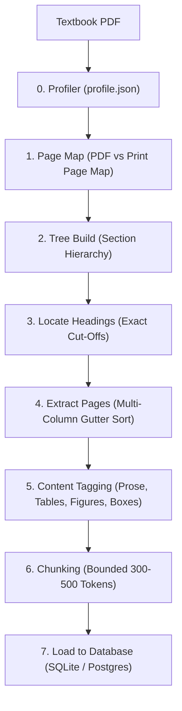

# Structure-Aware Textbook RAG: Architecture & System Design

This document details the system design, data models, ingestion pipeline, retrieval engines, and agent orchestration for the **Text-Book-RAG** project.

---

## 1. System Overview

Standard Retrieval-Augmented Generation (RAG) models often degrade on complex textbooks due to:
1. **Multi-Column Layouts & Header Collisions**: Standard PDF extraction merges adjacent columns or running headers into body text.
2. **Page vs. Print Discrepancies**: Physical PDF page indexes deviate from printed textbook pagination due to front-matter and appendices.
3. **Loss of Special Content**: Tables, boxes, learning objectives, and figure captions lose structural semantics when flattened into plain text.
4. **Vocabulary Mismatch**: Medical and academic literature uses precise taxonomic headings, whereas clinical queries use symptom-oriented vernacular.

### The Two-Layer Solution
* **Navigation Layer (Heading Tree)**: Hierarchical outline tracking `Chapters → Sections → Subsections` with physical and printed page coordinates, breadcrumb paths, and section summaries.
* **Retrieval Layer (Structured Chunks & Hybrid Search)**: Sections are subdivided into bounded passages (300–500 tokens) with 1-sentence overlaps. Specialized blocks (tables, figure captions, callouts) maintain dedicated typing. Search combines full-text search (BM25 / GIN) with dense vector embeddings.

---

## 2. Ingestion Pipeline



### Pipeline Modules
- `ingestion/extract_pages.py`: Multi-column line extraction, column gutter sorting, running header/footer pruning using PyMuPDF.
- `ingestion/page_map.py`: Reconciles PDF physical indexes with printed page numbers.
- `ingestion/section_tree.py`: Parses publisher table of contents into hierarchical outline trees.
- `ingestion/locate_headings.py`: Pinpoints coordinate boundaries for sections.
- `ingestion/tag_special_content.py`: Detects and annotates callout boxes, tables, and figure captions.
- `ingestion/chunk_sections.py`: Generates semantic text chunks bounded strictly by section headings.
- `ingestion/load_to_db.py`: Indexes chunks, sections, books, and figures into SQLite and PostgreSQL.

---

## 3. Database Schema

### `sections`
| Column | Type | Description |
| :--- | :--- | :--- |
| `id` | INTEGER | Primary key within book |
| `book_slug` | TEXT | Book identifier |
| `title` | TEXT | Section heading |
| `heading_path` | TEXT | Full breadcrumb hierarchy |
| `level` | INTEGER | Heading depth (1 = Chapter, 2 = Major Section, etc.) |
| `pdf_start`, `pdf_end` | INTEGER | Physical PDF page bounds |
| `page_start`, `page_end` | TEXT / INT | Printed textbook page numbers |
| `is_leaf` | BOOLEAN | Indicates terminal subsection |

### `chunks`
| Column | Type | Description |
| :--- | :--- | :--- |
| `chunk_id` | TEXT | Unique chunk identifier |
| `book_slug` | TEXT | Book identifier |
| `section_id` | INTEGER | Foreign key to `sections` |
| `content_type` | TEXT | `prose`, `table`, `box`, `figure_caption` |
| `sub_type` | TEXT | Detailed block classification |
| `page_start`, `page_end` | INTEGER | Printed page boundaries |
| `token_count` | INTEGER | Token size cap (300–500) |
| `text` | TEXT | Content text with soft hyphens de-hyphenated |

---

## 4. Modular Codebase Architecture

```
Text-Book-RAG/
├── agent/
│   ├── orchestrator.py    # Thin turn manager & SSE streaming dispatcher
│   ├── planner.py         # AttendingPlanner pre-step clinical reasoning engine
│   ├── offline.py         # Local smart synthesizer for offline execution
│   ├── providers.py       # Google Gemini & OpenAI tool-calling loops
│   ├── sanitizers.py      # Medical typography & citation integrity cleaners
│   ├── tools_spec.py      # Tool schema definitions & execution dispatcher
│   └── prompts.py         # Invariant cached system prompt & clinical persona
├── context/
│   ├── manager.py         # Multi-turn window manager & virtualization
│   ├── compactor.py       # Context summarization & token budgeting
│   ├── citations.py       # Session-scoped citation registries
│   └── models.py          # Session and message data models
├── ingestion/
│   ├── pipeline_worker.py # Background async worker for user PDF uploads
│   ├── chunk_sections.py  # Bounded semantic chunking (300-500 tokens)
│   ├── load_to_db.py      # SQLite (FTS5) & Postgres (pgvector) loader
│   └── section_tree.py    # Outline hierarchy & TOC extraction
├── retrieval/
│   ├── engine.py          # Factory function & re-exports
│   ├── base.py            # BaseEngine abstract specification
│   ├── sqlite.py          # SqliteEngine with FTS5 search
│   ├── postgres.py        # PostgresEngine with GIN & pgvector
│   ├── parallel.py        # Concurrent multi-tool executor
│   ├── router.py          # SemanticBookRouter & multi-book sovereignty
│   ├── tools.py           # Tool call implementations
│   └── models.py          # SectionHit, ChunkHit, SectionContent
├── storage/
│   └── object_store.py    # ObjectStorageProvider (Local & S3/MinIO)
├── ui/
│   ├── app.py             # FastAPI entrypoint (<65 lines)
│   ├── schemas.py         # Pydantic request & response models
│   ├── dependencies.py    # Auth, session, and rate-limiting dependencies
│   ├── auth.py            # User authentication & token management
│   ├── sessions.py        # Session persistence & auto-titling
│   ├── library.py         # User personal library & global catalog
│   ├── rate_limiter.py    # Daily quota enforcement with SQLite WAL & lock
│   ├── diagrams.py        # PyMuPDF on-the-fly diagram extraction & caching
│   ├── routers/
│   │   ├── auth.py        # /api/auth endpoints
│   │   ├── sessions.py    # /api/sessions endpoints
│   │   ├── chat.py        # /api/chat & /api/chat/stream endpoints
│   │   └── content.py     # /api/books, /api/user/library, /api/chunk, /api/figure
│   └── static/
│       ├── index.html     # Single-page interface (Consultation + Library Manager)
│       ├── styles.css     # Clean medical aesthetic, dual-scroll & carousel
│       └── app.js         # Frontend controller, SSE listener & drawer
├── issues/                # Production issue reports & diagnostics (ISSUE-*.md)
└── tests/
    ├── unit/              # Isolated service & sanitizer unit tests
    └── integration/       # 6-segment production test suite & E2E verification
```

---

## 5. Agent Orchestration & Clinical Planning

1. **AttendingPlanner Pre-Step Reasoning**:
   - Clinical inquiries trigger `AttendingPlanner` before tool dispatch.
   - Generates differential diagnoses, affected organ systems, and targeted medical search terms.
   - Emits structured `event: plan` over the SSE stream for immediate physician feedback.
2. **Invariant System Prompt & Prompt Caching**:
   - The clinical persona and core citation integrity rules (`INVARIANT_SYSTEM_PROMPT`) are placed as a static, immutable prefix.
   - Facilitates provider-side prompt caching (Gemini Context Caching) to reduce per-turn token latencies.
3. **Execution Strategy & Zero Multimodal Inference**:
   - Textbook figures are pre-cropped and stored in Object Storage; 0 multimodal vision tokens are sent to LLMs, saving token budget and latency.
   - When `GEMINI_API_KEY` is present, multi-turn ReAct loops run via Google GenAI (`gemini-flash-lite-latest`).
   - If keys are omitted or offline, `agent/offline.py` synthesizes answers with 100% availability.
4. **Semantic Book Routing**:
   - User Selection Sovereignty: When a user selects a subset of books, only those books are queried.
   - All Books Smart Routing: Analyzes query tokens and clinical plan against `BOOK_SPECIALTY_PROFILES` to rank and route to the top 1–2 most relevant volumes.
5. **Medical Typography & Citation Normalization**:
   - Raw LaTeX tags and hormone math delimiters are sanitized into clean Unicode.
   - Out-of-catalog bracketed references are converted to plaintext `(Ref X)` so only verified textbook passages become clickable interactive citation pills.

---

## 6. Multi-Book Scaling & Production Hardening

- **Dynamic Uploads**: Background worker accepts PDF uploads, validates digital text, builds TOC hierarchy, chunks, and commits atomically without blocking FastAPI.
- **Dual-Scroll Sidebar & Dedicated Library Manager**: Clean UI separation between active consultation sessions and textbook catalog management.
- **Six-Segment Verification**: Production resilience validated by 95 automated tests across Ingestion, Retrieval, Clinical Agent, REST API, UI/UX Accessibility, and Concurrency Stress.
- **Reference Masterwork**: Complete 4,273-page *Harrison's Principles of Internal Medicine (22nd Edition, 2025)* indexed and verified.


