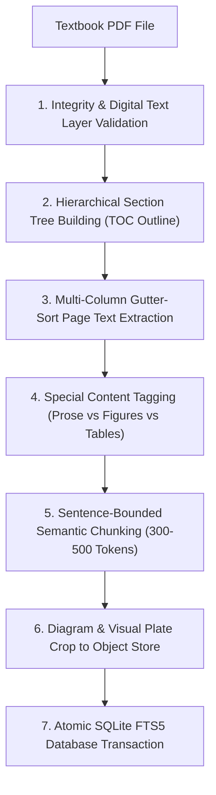

# CliniSource: System Architecture & Design Specification

This document provides the definitive system design, data models, ingestion pipeline, retrieval engines, agent orchestration, and presentation layer specifications for **CliniSource** — the Authoritative Universal Textbook Knowledge & Decision Intelligence Platform.

---

## 1. System Overview & The Two-Layer Architecture

Standard Retrieval-Augmented Generation (RAG) platforms routinely degrade when applied to complex academic and clinical reference textbooks due to:
1. **Multi-Column Layouts & Header Collisions**: Standard PDF extractors read horizontally across physical pages, inadvertently mingling adjacent vertical columns and injecting running headers/footers directly into body text.
2. **Page vs. Print Discrepancies**: Physical PDF page indices deviate significantly from physical printed pagination due to publisher Roman-numeral front-matter, introductory plates, and appendices.
3. **Loss of Structural Semantics**: Tables, callout boxes, diagnostic trees, and anatomical figures lose their structural relationships and meaning when flattened into unstructured text.
4. **Vocabulary Mismatch**: Reference literature relies on formal taxonomic structures and headings, whereas clinician and researcher queries use symptom-oriented, diagnostic, or vernacular phrasing.

### The Two-Layer Solution

CliniSource resolves these challenges through a synchronized two-layer architecture:

```
┌─────────────────────────────────────────────────────────────────┐
│          Navigation Layer: Structural Heading Hierarchy         │
│  Part → Chapter → Section → Subsection (Breadcrumb Outlines)    │
│  PDF Coordinate Bounds · Printed Page Mapping · Outline Trees   │
└──────────────────────────────┬──────────────────────────────────┘
                               │ Synchronized Foreign Key Binding
┌──────────────────────────────▼──────────────────────────────────┐
│          Retrieval Layer: Bounded Semantic Passages             │
│  Bounded 300–500 Token Chunks · 1-Sentence Overlaps             │
│  Specialized Block Typing (Prose, Tables, Figures, Boxes)       │
│  SQLite FTS5 BM25 Search · Dense Vector Hybrid Matching         │
└─────────────────────────────────────────────────────────────────┘
```

1. **Navigation Layer (Heading Tree)**: A hierarchical outline tree capturing publisher structure (`Chapters → Sections → Subsections`) with physical and printed page coordinates, breadcrumb paths, and section summaries.
2. **Retrieval Layer (Structured Chunks & Full-Text Search)**: Sections are subdivided into bounded passages (300–500 tokens) with 1-sentence overlaps. Specialized blocks (tables, figure captions, callouts) maintain dedicated typing. Search leverages SQLite FTS5 with BM25 ranking and optional pgvector embeddings.

---

## 2. Universal Agent Orchestration & Presentation Layer

The CliniSource reasoning engine functions universally across academic domains (**Medicine, Law, Engineering, Science, and Academia**) using a **Reference On-Demand** paradigm:

```
                              USER INQUIRY
                                    │
                                    ▼
                      ┌───────────────────────────┐
                      │    LLM Reasoning Engine   │ (Gemini 2.0 Flash / Local Fallback)
                      └─────────────┬─────────────┘
                                    │
             ┌──────────────────────┴──────────────────────┐
             ▼                                             ▼
    [Conceptual / Broad Inquiry]                 [Reference Grounding Required]
    • Conversational greeting                   • Exact cutoffs, drug titrations
    • High-level conceptual overview            • Statutory provisions & theorems
             │                                             │
    Direct Answer First                         Calls Tools On Demand:
    (0 search latency,                                     │
     0 tool calls)                                         ▼
                                              1. get_textbook_structure(keywords)
                                                 → Inspects hierarchical outline
                                                   │
                                                   ▼
                                              2. get_relevant_chunks(query, section_id)
                                                 → Fetches verified text passages
                                                   │
                                                   ▼
                                              3. get_media_and_tables(query, section_id)
                                                 → Retrieves diagrams & tables with
                                                   captions and descriptions
                                                   │
                                                   ▼
                                              LLM evaluates descriptions & emits
                                              verified citations [1], [2]
                                                   │
                                                   ▼
                      ┌───────────────────────────┐
                      │ Visual Presentation Layer │
                      └─────────────┬─────────────┘
                                    │
                   • Pristine Markdown tables for data/logic
                   • Authentic textbook diagram plates
                   • Strips stray math/LaTeX tags ($15, 35$)
                   • Binds citations [1] to Evidence Drawer
                                    │
                                    ▼
                             SSE Stream to UI
```

### Core Design Principles

1. **Direct Answer First**: Conversational and conceptual queries receive an immediate 2–3 paragraph answer with **zero retrieval latency and zero tool calls**.
2. **Reference On-Demand**: Specialized statutory, clinical, and scientific questions trigger dynamic tool execution only when ground-truth evidence is needed.
3. **Table-First Logic (Zero Synthetic Flowcharts)**: Fragile synthetic flowcharts (Mermaid) are completely eliminated to prevent syntax errors, pipe crashes, and layout distortions. All multi-step workflows, diagnostic criteria, and classifications are represented via clean, accessible Markdown tables or numbered decision sequences ($1 \rightarrow 2 \rightarrow 3$).
4. **Visual Presentation Layer (`agent/sanitizers.py`)**: A runtime normalization layer that:
   - Sanitizes raw LaTeX tags and strips stray math delimiters (`15$`, `35$`).
   - Normalizes ion and hormone typography (`Na⁺/K⁺-ATPase`, `Mg²⁺`, `T₄`, `TRβ₂`, `≥`, `≤`).
   - Auto-balances Markdown bold markers to prevent broken styling.
   - Converts publisher bibliography numbers into non-colliding `(Ref X)` text so only verified textbook passages become clickable interactive citation pills.

---

## 3. The 3 Universal ReAct Tools

Rather than hardcoded domain pipelines, the agent utilizes 3 domain-agnostic tools defined in `agent/tools_spec.py`:

| Tool | Signature | Purpose |
|---|---|---|
| `get_textbook_structure` | `(keywords: str, book_slug: str \| None)` | Searches the outline hierarchy, table of contents, and headings for matching chapters and sections. |
| `get_relevant_chunks` | `(query: str, book_slug: str \| None, section_id: int \| None, limit: int = 6)` | Retrieves granular passages and text blocks with 1-based citation IDs (`[1]`, `[2]`). |
| `get_media_and_tables` | `(query: str, book_slug: str \| None, section_id: int \| None)` | Surfaces authentic figures, diagram plates, and structured tables with semantic descriptions and captions. |

---

## 4. Column-Aware High-Resolution Figure Cropping Engine

Located in `ui/diagrams.py`, the diagram engine serves authentic visual plates directly from source PDFs:

```
┌─────────────────────────────────────────────────────────────────┐
│                 Figure Extraction & Cropping Engine             │
│                                                                 │
│  1. Check Figure Cache (ui/static/figures_cache/{chunk_id}.jpg) │
│  2. Check Storage Provider (StorageProvider.get_figure_path)    │
│  3. If Missing: Parse Chunk Page Bounds & Caption Token         │
│  4. Locate Physical PDF Page (0-based: page_start - 1)          │
│  5. Column-Aware Plate Bounding:                                │
│     • Detect Caption Rect (FIG X.Y regex)                       │
│     • Identify Column Gutter (Left vs Right Column)             │
│     • Trace Vector Drawings & Raster Image Bounding Rects       │
│     • Clip Strictly to Column Boundary (Zero Text Bleed)        │
│  6. Render Crisp 180 DPI JPEG & Store in Figures Cache          │
│  7. Strict Rejection: Return None if No Authentic Visual Plate   │
└─────────────────────────────────────────────────────────────────┘
```

- **Universal Column-Aware Plate Bounding**: When figures appear within two-column layouts, the bounding rect strictly isolates the diagram's column boundary (`col_x0` to `col_x1`), preventing adjacent-column text from contaminating the visual plate.
- **Strict Visual Rejection**: If a page contains only text and no vector graphics or raster drawings, the engine strictly returns `None`. It never serves arbitrary text paragraphs as pseudo-diagrams.
- **High-Resolution Output**: Renders at 180 DPI with 92% JPEG quality, providing clear legibility for anatomical structures, histological labels, and clinical decision trees.

---

## 5. Ingestion Pipeline



### Ingestion Components:
- `ingestion/extract_pages.py`: Multi-column line extraction, column gutter sorting, and running header/footer pruning using PyMuPDF.
- `ingestion/page_map.py`: Reconciles physical PDF indexes with printed page numbers.
- `ingestion/section_tree.py`: Parses publisher tables of contents into hierarchical outline trees.
- `ingestion/locate_headings.py`: Pinpoints coordinate boundaries for sections.
- `ingestion/tag_special_content.py`: Detects and annotates callout boxes, tables, and figure captions.
- `ingestion/chunk_sections.py`: Generates semantic text chunks bounded strictly by section headings.
- `ingestion/load_to_db.py`: Indexes chunks, sections, books, and figures into SQLite and PostgreSQL.
- `ingestion/pipeline_worker.py`: Background non-blocking worker for dynamic user PDF uploads with progress tracking.

---

## 6. Database Schema

### `sections`
| Column | Type | Description |
|---|---|---|
| `id` | INTEGER | Primary key within book |
| `book_slug` | TEXT | Book identifier |
| `title` | TEXT | Section heading |
| `heading_path` | TEXT | Full breadcrumb hierarchy |
| `level` | INTEGER | Heading depth (1 = Part/Chapter, 2 = Major Section, etc.) |
| `pdf_start`, `pdf_end` | INTEGER | Physical PDF page bounds |
| `page_start`, `page_end` | TEXT / INT | Printed textbook page numbers |
| `is_leaf` | BOOLEAN | Indicates terminal subsection |

### `chunks`
| Column | Type | Description |
|---|---|---|
| `chunk_id` | TEXT | Unique chunk identifier |
| `book_slug` | TEXT | Book identifier |
| `section_id` | INTEGER | Foreign key to `sections` |
| `content_type` | TEXT | `prose`, `table`, `box`, `figure_caption` |
| `sub_type` | TEXT | Detailed block classification |
| `page_start`, `page_end` | INTEGER | Printed page boundaries |
| `token_count` | INTEGER | Bounded token size (300–500) |
| `text` | TEXT | Content text with de-hyphenated reading continuity |

### `books`
| Column | Type | Description |
|---|---|---|
| `id` | INTEGER | Auto-increment primary key |
| `slug` | TEXT | Unique URL-safe book slug |
| `title` | TEXT | Authoritative textbook title |
| `total_pages` | INTEGER | Physical PDF page count |
| `specialty` | TEXT | Clinical or academic domain category |
| `created_at` | TIMESTAMP | Ingestion timestamp |

### `chunks_fts` (Virtual SQLite FTS5 Table)
Full-text search index over `chunks` utilizing the BM25 ranking function for sub-30ms keyword retrieval across tens of thousands of chunks.

### User & Session Schema (`app_users.db`)
- `users`: Tracks registered users and ephemeral guest accounts (`id`, `username`, `password_hash`, `is_guest`, `created_at`).
- `user_sessions`: Manages consultation sessions (`id`, `user_id`, `title`, `created_at`, `updated_at`).
- `user_messages`: Stores multi-turn messages and associated citations (`id`, `session_id`, `role`, `content`, `citations`, `created_at`).
- `user_books`: Manages personal textbook libraries and active consultation states (`user_id`, `book_slug`, `is_active`).
- `rate_limits`: Enforces daily quotas per user (`user_id`, `date`, `count`).

---

## 7. Modular Codebase Architecture

```
clinisource/
├── agent/
│   ├── orchestrator.py    # Thin turn manager & SSE streaming dispatcher
│   ├── offline.py         # Local smart synthesizer for offline execution
│   ├── providers.py       # Google Gemini & OpenAI tool-calling loops
│   ├── sanitizers.py      # Typography, math delimiters & citation cleaners
│   ├── tools_spec.py      # Universal 3-tool definitions & dispatcher
│   └── prompts.py         # Invariant cached system prompt & persona
├── context/
│   ├── manager.py         # Multi-turn window manager & virtualization
│   ├── compactor.py       # Context summarization & token budgeting
│   ├── citations.py       # Session-scoped citation registries
│   └── models.py          # Session and message data models
├── ingestion/
│   ├── pipeline_worker.py # Background async worker for user PDF uploads
│   ├── chunk_sections.py  # Bounded semantic chunking (300-500 tokens)
│   ├── load_to_db.py      # SQLite (FTS5) & Postgres (pgvector) loader
│   └── section_tree.py    # Outline hierarchy & TOC extraction
├── retrieval/
│   ├── engine.py          # Factory function & re-exports
│   ├── base.py            # BaseEngine abstract specification
│   ├── sqlite.py          # SqliteEngine with FTS5 BM25 search
│   ├── postgres.py        # PostgresEngine with GIN & pgvector
│   ├── parallel.py        # Concurrent multi-tool executor
│   ├── router.py          # SemanticBookRouter & multi-book sovereignty
│   ├── tools.py           # Tool call implementations
│   └── models.py          # SectionHit, ChunkHit, SectionContent
├── storage/
│   └── object_store.py    # ObjectStorageProvider (Local & S3/MinIO)
├── ui/
│   ├── app.py             # FastAPI entrypoint (<65 lines)
│   ├── schemas.py         # Pydantic request & response models
│   ├── dependencies.py    # Auth, session, and rate-limiting dependencies
│   ├── auth.py            # User authentication & token management
│   ├── sessions.py        # Session persistence & auto-titling
│   ├── library.py         # User personal library & global catalog
│   ├── rate_limiter.py    # Daily quota enforcement with SQLite WAL & lock
│   ├── diagrams.py        # Column-aware diagram extraction & caching
│   ├── routers/
│   │   ├── auth.py        # /api/auth endpoints
│   │   ├── sessions.py    # /api/sessions endpoints
│   │   ├── chat.py        # /api/chat & /api/chat/stream endpoints
│   │   └── content.py     # /api/books, /api/user/library, /api/chunk, /api/figure
│   └── static/
│       ├── index.html     # Single-page interface (Consultation + Library Manager)
│       ├── styles.css     # Clean medical aesthetic, dual-scroll & carousel
│       └── app.js         # Frontend controller, SSE listener & drawer
├── issues/                # Production issue reports & diagnostics (ISSUE-*.md)
└── tests/
    ├── unit/              # Isolated service & sanitizer unit tests
    └── integration/       # 6-segment production test suite (101 automated tests)
```

---

## 8. Mobile & Web Cross-Browser Responsive Design System

The frontend architecture adheres strictly to modern UI/UX and accessibility standards:

1. **Accessibility (WCAG AA Compliance)**: Text contrast $\ge 4.5:1$ across surfaces, visible focus rings (`focus-visible`), and semantic `aria-label` attributes on all interactive controls.
2. **Touch Targets**: All buttons, drawer triggers, and interactive elements maintain minimum touch targets of $44 \times 44\text{px}$ with $\ge 8\text{px}$ spacing between targets.
3. **Independent Dual-Scroll Workspace**: When consultation history and library books share vertical space in desktop viewports, each container features independent smooth scrolling (`overflow-y: auto`) without vertical squishing.
4. **Mobile Drawer Navigation**: Below 1024px breakpoints, the sidebar collapses into a backdrop overlay drawer toggled via an accessible header button.
5. **Reduced Motion**: All animations respect the `@media (prefers-reduced-motion: reduce)` media query.

---

## 9. Production Concurrency, User Isolation & Security

- **SQLite WAL Mode**: Configured with Write-Ahead Logging (`PRAGMA journal_mode=WAL;`), permitting unlimited concurrent readers during active background writes.
- **Thread-Safe Rate Limiting**: Intra-process `threading.Lock()` coupled with `BEGIN IMMEDIATE;` SQLite transactions prevents Time-of-Check to Time-of-Use (TOCTOU) race conditions under concurrent burst loads.
- **User Library Sovereignty**: Retrieval strictly honors the user's active textbook selection, preventing cross-specialty pollution while enabling smart routing across broad queries.
- **Secure Authentication**: HttpOnly, SameSite=Lax session cookies protect authentication tokens against cross-site scripting (XSS).

---

## 10. Six-Segment Verification Architecture

The system is validated by an automated test suite spanning 6 core production pillars (101 passed tests):

1. **Segment 1: Ingestion & Document Pipeline**: Scanned/corrupt PDF handling, TOC fallbacks, semantic chunking invariants, and atomic transaction commits.
2. **Segment 2: Retrieval & Semantic Routing**: FTS5 BM25 search, smart routing sovereignty, and specialty filters.
3. **Segment 3: Agent & SSE Streaming**: Direct Answer First execution, tool-calling loops, figure emission, and stream integrity.
4. **Segment 4: REST API & User Isolation**: Auth workflows, session CRUD, user library isolation, and figure caching headers.
5. **Segment 5: Frontend E2E & UI/UX**: Dual-scroll layout, Evidence Drawer, upload modal, and responsive viewport integrity.
6. **Segment 6: Concurrency & Stress**: SQLite WAL concurrent reads/writes, async worker queues, and rate-limiter thread safety.
