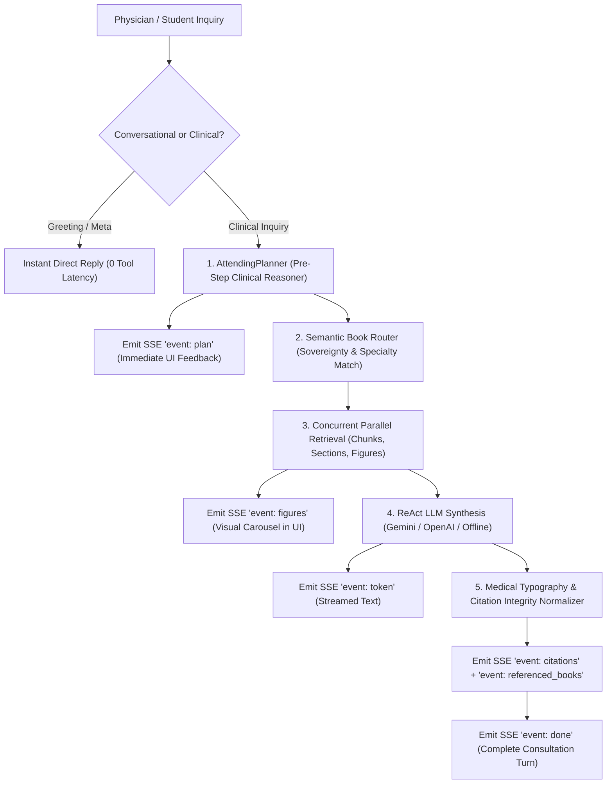

# Clinical Agent & Reasoning Engine: Architecture Guide

This document details the reasoning, planning, retrieval routing, and streaming architecture of the **CliniSource Clinical Agent**.

---

## 1. Clinical Reasoning Philosophy

General-purpose conversational AI models frequently stumble in medical question-answering because they jump directly to generating prose before structuring a diagnostic differential or verifying ground truth against the clinical reference canon.

In CliniSource, the agent mimics an **Attending Physician**:
1. **Analyze First**: Formulate diagnostic hypotheses, identify the physiological organ systems involved, and generate precise medical search terms.
2. **Retrieve Authoritative Evidence**: Query the medical textbook library using specialized full-text search tools.
3. **Verify Every Claim**: Every diagnostic recommendation or pharmacological dosage must be tied to an explicit, verified textbook passage.
4. **Clean Presentation**: Eliminate LaTeX notation errors, format clean Unicode medical typography, and render citing evidence interactively.

---

## 2. Agent Architecture Overview

---

## 3. Core Engine Components

### 1. AttendingPlanner (Pre-Step Clinical Reasoner)
Located in `agent/planner.py`, `AttendingPlanner` is a lightweight, structured reasoning engine executed before tool dispatch.
- **Why It Matters**: Instead of executing generic keyword searches (e.g., searching *"tired and dark skin"*), `AttendingPlanner` maps vernacular symptoms to clinical terminology:
  - **Diagnostic Hypotheses**: `["Primary Adrenal Insufficiency", "Addison's Disease"]`
  - **Organ Systems**: `["Endocrinology", "Adrenal Cortex"]`
  - **Search Queries**: `["adrenal cortex cortisol deficiency", "ACTH hyperpigmentation POMC"]`
- **Immediate Streaming Feedback**: The plan is emitted as an SSE `event: plan` before textbook searching completes, giving the clinician instant insight into how the AI is approaching the case.

### 2. Invariant System Prompt & Prompt Caching
Located in `agent/prompts.py`, `INVARIANT_SYSTEM_PROMPT` contains the clinical persona, ground truth contract, and citation syntax rules.
- **Why It Matters**: In multi-turn consultations, re-sending a 2,000-token system prompt on every turn increases latency and cost.
- **Prompt Caching Integration**: By keeping the system prompt static and placed as an immutable prefix, Google Gemini's **Context Caching** caches the prompt tokens on Google's servers. Subsequent turns reuse the cached context, reducing Time-to-First-Token (TTFT) by up to 60–80%.

### 3. Semantic Book Router (User Sovereignty & Smart Routing)
Located in `retrieval/router.py`, the router determines which textbooks to query:
- **User Selection Sovereignty (Iron Rule)**: If a user explicitly selects a textbook (or subset of textbooks) in the UI, the router **strictly honors** that selection without modification.
- **All Books Smart Routing**: When querying the entire library ("All Books"), the router evaluates query tokens and the clinical plan against `BOOK_SPECIALTY_PROFILES` (scoring keywords, titles, and descriptions), dynamically routing the query to the top 1–2 most relevant textbooks.
- **Multi-Volume Attribution**: Queries requiring cross-disciplinary insights (e.g. diabetic ketoacidosis) simultaneously cite both *Internal Medicine (Harrison's)* and *Endocrinology (Williams)*.

### 4. Zero-Multimodal LLM Inference Strategy
Located in `agent/orchestrator.py` & `storage/object_store.py`:
- **The Problem**: Passing high-resolution textbook diagram images directly to multimodal LLMs (like GPT-4V or Gemini Vision) consumes tens of thousands of vision tokens per query and adds 5–10 seconds of latency.
- **The Solution**: 
  1. High-resolution diagrams are pre-cropped at ingestion time into Object Storage.
  2. The agent retrieves figure captions using text search tools.
  3. Figure metadata cards are emitted directly to the frontend over SSE (`event: figures`) in parallel with text streaming.
  4. The LLM processes **pure text context only** (0 vision tokens used), ensuring blazing-fast response times while still delivering rich medical figures to the user.

### 5. Medical Typography & Citation Sanitizer
Located in `agent/sanitizers.py`, all generated responses undergo post-processing:
- **LaTeX Normalization**: Cleans up raw LaTeX delimiters and typesetting artifacts (e.g., `$T4$` &rarr; `T₄`, `$\beta$` &rarr; `β`, `\text{...}` &rarr; plain text).
- **Bibliography Reference Disambiguation**: Raw textbook text often contains publisher reference numbers (e.g., `[14]`). The sanitizer converts raw references to `(Ref 14)` so only verified interactive citation pills (`[1]`) become clickable links that open the Evidence Drawer.
- **Soft-Hyphen Removal**: Strips line-break hyphens (`glu- \n cose` &rarr; `glucose`).

---

## 4. Multi-Turn Session Management & Token Virtualization

Located in `context/manager.py`:
- **Token Budget Virtualization**: Keeps conversations responsive over 10+ turns by maintaining a sliding window of recent conversation history.
- **Tool Compaction**: Once a tool result is synthesized into clinical text, raw multi-thousand-token JSON results from previous turns are pruned from the context window, keeping the prompt lean and within optimal token limits.
- **Session Citation Accumulation**: Maintains a session-wide citation registry so that citations referenced in earlier turns can still be inspected in the Evidence Drawer throughout the entire consultation.

