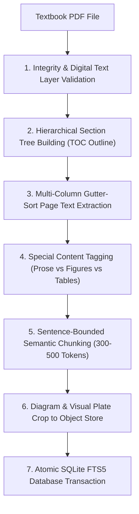

# Textbook Ingestion & Document Pipeline: Engineering Guide

This document provides a comprehensive, human-oriented explanation of how raw PDF medical textbooks are transformed into structured, searchable clinical knowledge in **TextBook RAG**.

---

## 1. Why Standard PDF Ingestion Fails on Textbooks

Standard PDF extractors (like basic `pypdf` or `pdfplumber`) fail when parsing academic medical textbooks because:
1. **Multi-Column Layouts**: Textbooks format text in 2 or 3 parallel vertical columns. Standard text extraction reads horizontally across the entire page width, mingling sentences from Column A with Column B into incoherent gibberish.
2. **Running Headers & Footers**: Book titles, chapter names, and page numbers at the top and bottom of every page get injected into the middle of clinical sentences.
3. **Loss of Heading Hierarchy**: Sections lose their nested relationships (`Part → Chapter → Section → Subsection`). A paragraph describing "Treatment" loses the context of which disease is being treated.
4. **Pagination Mismatch**: The 50th page in a physical textbook might be page 72 of the PDF file due to publisher Roman-numeral front-matter.
5. **Specialized Content Flattening**: Diagnostic algorithms, drug dosage tables, and figure captions get flattened into unreadable paragraphs.

---

## 2. Ingestion Pipeline Workflow

---

## 3. Step-by-Step Pipeline Details

### Step 1: Validation & DRM Check
- **Purpose**: Verify that the uploaded file is a valid, readable digital PDF before consuming processing resources.
- **Key Checks**:
  - Validates `%PDF` file signature.
  - Detects publisher password locks and DRM restrictions (`doc.is_encrypted`).
  - Evaluates digital text layer: samples multiple pages to confirm characters can be extracted. If the document consists of scanned image photocopies without OCR, it raises a clear, reassuring error advising the user to provide an OCR-processed copy.

### Step 2: Hierarchical Section Tree Building
- **Purpose**: Reconstruct the textbook's full navigation outline tree.
- **How It Works**:
  - Leverages native PDF Table of Contents (`doc.get_toc()`).
  - Maintains an ancestor stack to calculate parent-child relationships and breadcrumbs (e.g. `Part 12 Endocrinology > Section 3 Diabetes > Chapter 416 Management and Therapies`).
  - Computes exact physical page ranges (`pdf_start`, `pdf_end`) for each section.
  - **Fallback**: If a book lacks a native TOC outline, font-size heuristics analyze bold, large-font header lines across the document to reconstruct an outline.

### Step 3: Multi-Column Gutter-Sorted Text Extraction
- **Purpose**: Extract text in natural human reading order.
- **How It Works**:
  - Prunes running headers (top 35pt) and footers (bottom 35pt) using PyMuPDF bounding rects.
  - Analyzes block horizontal coordinates (`x0`, `x1`): divides the page into left and right columns using the median gutter.
  - Sorts blocks vertically within the left column from top to bottom, followed by the right column top to bottom.
  - Resolves hyphenated words split across line breaks (`corti- \n sol` &rarr; `cortisol`).

### Step 4: Special Content Tagging
- **Purpose**: Classify distinct content blocks so the retrieval engine treats them appropriately.
- **Classifications**:
  - `prose`: Core explanatory paragraphs and diagnostic guidelines.
  - `table`: Clinical laboratory values, drug dosing tables, differential lists.
  - `figure_caption`: Diagnostic images, anatomical plates, and hormone pathway captions.
  - `box`: High-yield clinical pearls and warning boxes.
- **Noise Filtering**: Automatically detects and tags end-of-chapter academic literature bibliographies and indices so reference lists are excluded from primary medical evidence.

### Step 5: Bounded Semantic Chunking
- **Purpose**: Break long chapters into bite-sized passages optimized for LLM context windows.
- **Chunk Invariants**:
  - **Strict Section Containment**: Chunks never cross section boundaries. A chunk from "Etiology" will never bleed into "Treatment".
  - **Token Boundaries**: Bounded between 300 and 500 tokens (median ~450 tokens) to ensure complete clinical ideas without token truncation.
  - **1-Sentence Overlap**: The last sentence of each chunk is prepended to the next chunk to preserve continuity across boundaries.
  - **Section Breadcrumbs**: Every chunk stores an `embed_text` prefixed with its hierarchical path (e.g., `[Cardiology > Acute Coronary Syndromes]`), guaranteeing semantic relevance even if the body paragraph only mentions generic pronouns.

### Step 6: Diagram Extraction & Object Storage
- **Purpose**: Extract high-resolution visual plates at ingestion time so that the LLM inference loop requires zero raw image tokens.
- **How It Works**:
  - When a chunk contains a figure caption (e.g., `FIGURE 416-2 Management of DKA`), the pipeline searches the corresponding PDF page for the figure token.
  - Crops the diagram region at 130 DPI into a JPEG image stored via `StorageProvider` (`LocalStorageProvider` or `S3StorageProvider`).
  - The image reference is linked to the chunk ID, allowing the web UI to fetch and display the diagram instantly.

### Step 7: Atomic Database Transaction
- **Purpose**: Index books, sections, chunks, and full-text search tables with zero downtime or partial writes.
- **How It Works**:
  - Inserts all sections and chunks in bulk batches.
  - Indexes chunks into the virtual SQLite `chunks_fts` table using the FTS5 full-text engine with BM25 ranking.
  - Wraps the entire book ingestion in an atomic SQLite transaction: if any error occurs midway, the transaction rolls back cleanly, leaving the existing catalog intact.

---

## 4. Ingestion Performance & Scalability

| Textbook | Total Pages | Sections | Chunks Indexed | Ingestion Time |
|---|---|---|---|---|
| **Anatomy and Physiology (2e)** | 1,347 | 409 | 3,240 | ~35 seconds |
| **Williams Textbook of Endocrinology (15e)** | 2,319 | 2,944 | 9,016 | ~65 seconds |
| **Harrison's Principles of Internal Medicine (22e)** | 4,273 | 591 | 16,963 | ~223 seconds (~3.7 min) |

- **Memory Efficiency**: Ingestion streams pages sequentially using PyMuPDF iterators without loading the entire document into RAM, allowing multi-thousand-page textbooks to process easily within constrained server memory limits (under 512 MB).

