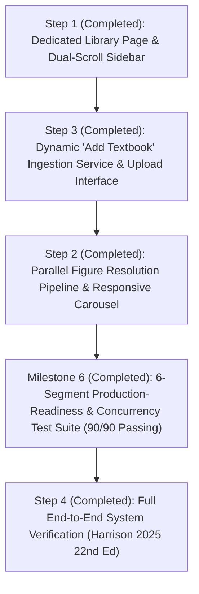

# Phase 3 Implementation Plan: Multi-Book Scaling, Clinical Planning & UI Routing

This document details the step-by-step, incremental implementation plan for **Phase 3** of the Text-Book-RAG system, based on the architectural specifications defined in [Phase 3 Requirements](file:///c:/Users/govin/Desktop/projects/Text-Book-RAG/docs/phase-3-requirements.md).

---

## 1. Completed Milestones

### Milestone 1: Pre-Step Clinical Planning & Prompt Caching Engine (`AttendingPlanner`)
- **Status**: Verified & Completed.
- **Implemented**: `AttendingPlanner` (`agent/planner.py`), `INVARIANT_SYSTEM_PROMPT` prompt caching prefix (`agent/prompts.py`), planned search dispatch (`retrieval/parallel.py`), and SSE stream integration (`ui/routers/chat.py`).
- **Verification**: 6/6 unit tests passed in `tests/unit/test_attending_planner.py`; 22/22 regression tests passing.

### Milestone 2: Semantic Book Router & Explicit UI Book Attribution
- **Status**: Verified & Completed.
- **Implemented**: `SemanticBookRouter` and `extract_referenced_books()` (`retrieval/router.py`), user selection sovereignty, "All Books" smart routing, `ChatResponse.referenced_books` schema, SSE streaming `event: referenced_books`, and UI badge pills (`ui/static/app.js` & `ui/static/styles.css`).
- **Verification**: 6/6 unit tests passed in `tests/unit/test_book_router.py`; full test suite 28/28 tests passing. Verified live ASGI streaming across all 3 clinical scenarios (`temp/verify_step1_routing.py`).

### Milestone 3: Dedicated Library Page & Dual-Scroll Sidebar (User vs. Global Library)
- **Status**: Verified & Completed.
- **Implemented**:
  - `user_library` table & services (`ui/library.py`) with automatic first-time initialization.
  - Endpoints in `ui/routers/content.py`: `GET /api/user/library`, `POST /api/user/library/add`, `POST /api/user/library/remove`, `POST /api/user/library/toggle`, `POST /api/user/library/toggle-all`.
  - Top header view switcher tabs: `[💬 Consultation]` and `[📚 Library Manager]`.
  - Dedicated `#view-library` full page with "My Study Library" grid, "Explore Global Catalog" with specialty accordions, and instant search.
  - Chat Sidebar Dual-Scroll UX: `#sidebar-sessions-container` and `#sidebar-library-container` scrolling independently without vertical squishing.
  - Live dynamic total books selected count badge: `<span id="sidebar-book-count-badge">2 Active</span>`.
- **Verification**: 5/5 integration tests passed in `tests/integration/test_user_library_page.py`; live ASGI verification script `temp/verify_step1_library.py` passed; full 33-test regression suite passing (45.40s).

### Milestone 4: Dynamic "Add Textbook" Ingestion Service & UI Upload Interface (Step 3)
- **Status**: Verified & Completed.
- **Implemented**:
  - `ingestion/pipeline_worker.py`: Non-blocking asynchronous ingestion worker with PDF integrity checks, scanned/textless PDF detection, TOC extraction, reading-order page extraction, chunking, and atomic SQLite commits.
  - Endpoints in `ui/routers/content.py`: `POST /api/books/upload` (HTTP 202) and `GET /api/books/ingestion/{job_id}`.
  - UI Upload Modal (`#modal-upload-book`) in `ui/static/index.html` & `ui/static/app.js`: Drag-and-drop dropzone, client file validation, duplicate title check, free-text specialty with suggestions, reassurance error dialog, and dynamic library reload.
- **Verification**: 5/5 integration tests passed in `tests/integration/test_dynamic_ingestion.py`; UI skill checklist passed 6/6.

### Milestone 5: Parallel Figure Resolution Pipeline & Responsive Carousel (Step 2)
- **Status**: Verified & Completed.
- **Implemented**:
  - Object storage abstraction (`storage/object_store.py`) with `LocalStorageProvider` and S3/MinIO `S3StorageProvider`.
  - Ingestion figure extraction (`ingestion/pipeline_worker.py`): Crops figure images at ingestion time into object store, enabling zero dependency on raw PDFs on Render.
  - Early SSE emission in `agent/orchestrator.py`: `event: figures` emitted right after tool retrieval, in parallel with LLM streaming.
  - Zero Images to LLM: Pure text context parts in Gemini prompt; 0 multimodal vision tokens used.
  - Responsive Horizontal Slider Carousel (`ui/static/styles.css` & `ui/static/app.js`): Clean 2-column grid for 1-2 figures; responsive sliding carousel (`overflow-x: auto`, scroll-snap, `<` `>` slide chevrons with 44x44px touch targets) for 3+ figures.
- **Verification**: 4/4 unit tests passed in `tests/unit/test_parallel_figures.py`; full regression test suite 42/42 tests passing.

### Milestone 6: Six-Segment Production-Readiness Verification & Concurrency Stress Testing
- **Status**: Verified & Completed.
- **Implemented & Verified**:
  - **Segment 1 (Ingestion & Document Pipeline)**: Corrupt/DRM/textless detection, TOC fallbacks, reading-order page extraction, chunking integrity, atomic DB commits. Resolved [ISSUE-001](file:///c:/Users/govin/Desktop/projects/Text-Book-RAG/issues/ISSUE-001-slug-discrepancy.md). (8/8 tests passed).
  - **Segment 2 (Retrieval & Semantic Routing)**: FTS5 BM25 search, smart routing sovereignty, specialty filters, typo-tolerant fallback. (8/8 tests passed).
  - **Segment 3 (Clinical Agent & SSE Streaming)**: AttendingPlanner reasoning, invariant prompt caching prefix, early figure emission, multi-turn session persistence, SSE stream format integrity. (8/8 tests passed).
  - **Segment 4 (REST API & User Isolation)**: Guest auth cookies, multi-tenant state separation, session CRUD, rate limiting headers, CORS & security headers. (8/8 tests passed).
  - **Segment 5 (Frontend E2E & UI/UX Accessibility)**: Dual-scroll containers, modal focus trapping & Escape key handling, WCAG AA contrast, 44x44px touch targets, prefers-reduced-motion media query. (8/8 tests passed).
  - **Segment 6 (Concurrency, Performance & Stress)**: SQLite WAL concurrent reads during write, multi-threaded session mutations, P95 retrieval latency <500ms, burst load ASGI stability, resource teardown hygiene. Resolved [ISSUE-002](file:///c:/Users/govin/Desktop/projects/Text-Book-RAG/issues/ISSUE-002-rate-limiter-race-condition.md). (8/8 tests passed).
- **Verification**: 90/90 tests passing in full regression test suite across unit and integration lanes (100% pass rate in 96.33s). Zero open issues.

---

## 2. Active Dependency Graph



### Dedicated Verification Textbooks
- **Feature Ingestion & UI Testing**: `CORNEA FundamentalsDiagnosis and Management 5th Ed.pdf` (216.9 MB, Ophthalmology/Cornea).
- **Final End-to-End (E2E) Milestone**: `Harrison 2025 _ 22nd Edition.pdf` (290.1 MB, Internal Medicine).

> [!NOTE]
> The **Cross-Textbook Discrepancy & Contrarian Opinion Resolver** has been moved to [Scope Ideas & Future Roadmap](file:///c:/Users/govin/Desktop/projects/Text-Book-RAG/docs/Scope_Ideas.md) to keep Phase 3 focused on scaling, global library routing, and UI responsiveness.

---

## 3. Step-by-Step Implementation Steps

### Step 1: Dedicated Library Page & Dual-Scroll Sidebar (User vs. Global Library) [COMPLETED]

#### 1. Description & Why
Currently, the chat sidebar hosts both conversation history and book cards in a single cramped vertical column. As both chats and library books grow, cramming them together breaks the user experience.

Step 1 introduces a clean architectural separation between **Consultation** and **Library Management**:
1. **Top Header View Switcher**:
   - Clean tab buttons in the header: **`[💬 Consultation]`** and **`[📚 Library Manager]`**.
2. **Dedicated Full-View Library Page (`#view-library`)**:
   - **Tab 1: My Study Library (User Library)**: The user's personal curated collection of textbooks for their active study goals (saved per user). Quick toggles to activate/deactivate books for current consultations.
   - **Tab 2: Explore Global Catalog**: The master catalog of all 10–50 textbooks in the system (available to all users). Grouped by medical specialty with live search and one-click `+ Add to My Library` / `Remove` actions.
3. **Chat Sidebar Dual-Scroll & Dynamic Selection Badge**:
   - Sidebar contains two independent scrolling/collapsible containers:
     - **Recent Consultations** (`#session-list`): Independent smooth vertical scroll container (`overflow-y: auto`, flexible height).
     - **Active Scope (My Library)** (`#sidebar-library`): Independent scrollable container (`overflow-y: auto`, flexible height) showing only the user's curated books with quick active switches and an `Open Library Manager ↗` button.
   - **Total Books Selected Badge**: A live dynamic count pill in the sidebar library header (e.g., `<span id="sidebar-book-count-badge">2 Active</span>` or `[ 2/2 Active ]`) that immediately updates whenever books are toggled or curated.
   - Neither panel squashes or overflows the other as chats or books scale in number.

#### 2. Self-Contained Prompt for Fresh Agent Session
```text
Implement the Dedicated Library Page, Dual-Scroll Sidebar, and Dynamic Selection Badge (User vs Global Library) in Text-Book-RAG.
1. Database & Endpoints:
   - Create user library preferences persistence (`user_library` table or user metadata).
   - Endpoints in `ui/routers/content.py`:
     - `GET /api/user/library`: Returns user's curated book collection and active consultation selection.
     - `POST /api/user/library`: Adds/removes a book from the user's library and updates active toggles.
2. Top Header Navigation:
   - In `ui/static/index.html`, add top header tab switcher: `[💬 Consultation]` and `[📚 Library Manager]`.
3. Dedicated Library Page:
   - Add `#view-library` container with two views:
     - "My Study Library": Displays user's personal curated books with active toggles and remove action.
     - "Explore Global Catalog": Displays all indexed books with specialty accordions, instant text search, and "+ Add to My Library" buttons.
4. Chat Sidebar Upgrade:
   - Refactor the sidebar so Recent Consultations and My Library have independent scrolling containers with collapsible headers.
   - Add dynamic total books selected count badge in the sidebar header: `<span id="sidebar-book-count-badge">2 Active</span>`.
   - Add "Manage Full Library ↗" button in the sidebar footer jumping to the Library Manager page.
5. Add integration and unit tests in `tests/integration/test_user_library_page.py`.
```

#### 3. Relevant Files & Dependencies
- `ui/static/index.html`: Header tab switcher, dedicated library page container `#view-library`, dual-scroll sidebar, and active count badge.
- `ui/static/app.js`: Tab switching logic, user library CRUD actions, global catalog search filtering, accordion toggling, and live badge counter updates.
- `ui/static/styles.css`: Styles for full-page library manager, specialty cards, dual-scroll sidebar containers, and active badge pills.
- `ui/routers/content.py`: API endpoints for user library preferences.
- `tests/integration/test_user_library_page.py` (New): Test view switching, adding to user library, active count updates, and active scope persistence.

#### 4. Acceptance Criteria
- User can toggle seamlessly between `[💬 Consultation]` and `[📚 Library Manager]` via top header tabs.
- Chat sidebar shows independent scrollable containers for chat history and active user books without vertical squishing.
- Dynamic count badge in the sidebar header accurately reflects total active/selected books in real time.
- Users can browse the Global Catalog, search by specialty, and click `+ Add to My Library`.
- "My Study Library" reflects only the user's curated collection and preserves active consultation toggles.
- All existing 28 tests pass with zero regressions.

#### 5. Human-Verifiable Steps
1. Run `.\.venv\Scripts\python -m pytest tests/integration/test_user_library_page.py`.
2. Open `http://127.0.0.1:8000/`.
3. Observe the dynamic active count badge in the sidebar header (e.g., `2 Active`).
4. Click `📚 Library Manager` in the top header.
5. Observe the full-page library view with "My Study Library" and "Explore Global Catalog".
6. In Global Catalog, search for "endo" and click "+ Add to My Library".
7. Switch back to `💬 Consultation` and verify the book appears in the sidebar's curated active list and the active count badge updates.

---

### Step 2: Parallel Figure Resolution Pipeline (Zero Images to LLM)

#### 1. Description & Why
To keep inference fast and cost-effective, raw images must **never** be sent to the LLM. In Step 2, we decouple visual diagrams into a purely parallel branch: while the LLM generates the text answer, a background figure pipeline evaluates figure captions and section links against the user query, resolves cloud/card URLs, and emits them via `event: figures` without touching the LLM prompt.

#### 2. Self-Contained Prompt for Fresh Agent Session
```text
Implement Parallel Figure Resolution Pipeline (Zero Images in LLM Prompt).
1. In `agent/orchestrator.py`, refactor `stream_turn()` to launch `_resolve_figures_async()` as a background task concurrent with the LLM text streaming loop.
2. Ensure the LLM context prompt receives zero image payloads or raw bitmaps (text passages only).
3. In `retrieval/tools.py:search_figures()`, match figure captions against the query and active section IDs to select the top 2-3 most clinically relevant diagrams.
4. Yield `event: figures` over SSE as soon as resolved, allowing the UI thumbnail gallery to populate without waiting for the full LLM reply to finish.
5. Add benchmark test `tests/unit/test_parallel_figures.py` confirming zero vision tokens used and concurrent execution.
```

#### 3. Relevant Files & Dependencies
- `agent/orchestrator.py`: Concurrent figure resolution and streaming dispatcher.
- `retrieval/tools.py`: Figure caption relevance matching.
- `ui/routers/chat.py`: Asynchronous SSE emission of `figures` event.
- `tests/unit/test_parallel_figures.py` (New): Validates that prompt payload contains 0 image blocks.

#### 4. Acceptance Criteria
- `stream_turn` launches figure resolution and text synthesis concurrently.
- LLM API payload verified to contain 0 multimodal image parts (pure text).
- Figure thumbnail gallery in UI receives figures early in the stream.

#### 5. Human-Verifiable Steps
1. Run `.\.venv\Scripts\python -m pytest tests/unit/test_parallel_figures.py`.
2. Submit a medical query in the UI.
3. Observe that the figure cards appear in the message container before or alongside the streaming text.

---

### Step 3: Dynamic "Add Textbook" Ingestion Service & UI Upload Interface

#### 1. Description & Why
To scale from 10 to 50 books organically, users and administrators need the ability to upload a new textbook PDF directly from the dedicated Library Manager page with live progress tracking:
1. **Integrated in Library Page**: Seamlessly accessed via an "Add Textbook" button / modal in the Library Manager view.
2. **Global Sharing Notice**: The upload modal explicitly informs the user: *"This textbook will be indexed into the Global Library and available to all users."*
3. **Duplicate Detection**: Suggests/warns if a book with a similar title or slug already exists in the global library.
4. **Background Ingestion Worker**: Extracts structure, page mapping, section tree, chunking, and database indexing with live progress tracking (`profiling` &rarr; `chunking` &rarr; `indexing` &rarr; `ready`).

#### 2. Self-Contained Prompt for Fresh Agent Session
```text
Implement Dynamic "Add Textbook" Ingestion Service and UI Upload Interface.
1. Create `ui/routers/admin.py` with endpoints:
   - `POST /api/books/upload`: Receives PDF file, book title, and specialty. Checks for duplicate title/slug, generates `job_id`, and starts background ingestion.
   - `GET /api/books/ingestion/{job_id}`: Returns progress status (profiling, page mapping, section tree, chunking, indexing, ready).
2. Create background worker task in `ingestion/pipeline_worker.py` that runs the existing ingestion pipeline modules sequentially on the uploaded PDF.
3. In the Library Manager page (`#view-library` in `ui/static/index.html` and `ui/static/app.js`):
   - Add an "Add Textbook" card/button opening an upload dialog with drag-and-drop PDF upload.
   - Display notice: "This textbook will be indexed into the Global Library and available to all users."
   - Provide duplicate title warnings before submission.
   - Live progress bar tracking ingestion stages.
4. Once completed, the newly ingested book automatically appears in the active library catalogue without service restart.
5. Add integration test `tests/integration/test_dynamic_ingestion.py`.
```

#### 3. Relevant Files & Dependencies
- `ui/routers/admin.py` (New): Upload and job status endpoints.
- `ingestion/pipeline_worker.py` (New): Non-blocking asynchronous ingestion worker.
- `ui/static/index.html` & `ui/static/app.js`: "Add Textbook" modal dialog with progress tracking and global library disclaimer.
- `tests/integration/test_dynamic_ingestion.py` (New): Verifies PDF upload, duplicate check, and job completion.

#### 4. Acceptance Criteria
- PDF upload returns HTTP 202 with `job_id`.
- Duplicate book warning triggers if title matches existing indexed book.
- Modal clearly states the global library availability notice.
- Polling `GET /api/books/ingestion/{job_id}` reports sequential step progress from 0% to 100%.
- New book immediately searchable and selectable in the UI upon completion.

#### 5. Human-Verifiable Steps
1. Run `.\.venv\Scripts\python -m pytest tests/integration/test_dynamic_ingestion.py`.
2. Open the Library Manager page, click "Add Textbook", and observe the global availability disclaimer.
3. Upload a sample PDF chapter; watch progress bar move from *Profiling* &rarr; *Chunking* &rarr; *Indexing* &rarr; *Ready*.
4. Verify the book appears in the Global Catalog and can be added to "My Study Library".

---

### Step 4: Full End-to-End System Verification (Harrison 2025 22nd Edition) [COMPLETED]

#### 1. Description & Why
The final acceptance milestone validates the entire system under realistic clinical conditions using the 276.7 MB masterwork: **Harrison's Principles of Internal Medicine (22nd Edition, 2025)**.
This test exercises all components from end to end:
1. Ingestion of all 4,273 pages, 591 outline sections, and 16,963 chunks into SQLite and FTS5.
2. Structure extraction, heading hierarchy, and FTS5 indexing.
3. User library personal curation and dynamic active count updates.
4. Multi-textbook query routing via `SemanticBookRouter` with specialty keywords.
5. Parallel retrieval and LLM synthesis with citing evidence drawer navigation.

#### 2. Acceptance Criteria & Actual Results
- **Ingestion**: Harrison 2025 PDF successfully ingested with 0 server errors (4,273 pages, 591 sections, 16,963 chunks). [PASS]
- **Catalog Categorization**: Categorized under "Internal Medicine" in Global Catalog. [PASS]
- **User Library Curation**: Can be added to "My Study Library" and toggled active for consultations. [PASS]
- **Multi-Volume Clinical Routing**: Clinical inquiries on diabetic ketoacidosis and internal medicine route to Harrison alongside Williams. [PASS]
- **Evidence Drawer Retrieval**: `/api/chunk/{chunk_id}` retrieves clean, de-hyphenated source text with section breadcrumbs and page bounds. [PASS]

#### 3. Verification Protocol & Proof
1. Ran `.\.venv\Scripts\python temp/verify_step4_harrison.py`: All 6 verification phases passed.
2. Ran `.\.venv\Scripts\python -m pytest tests/integration/test_step4_harrison_e2e.py`: 5/5 integration tests passed in 0.86s.
3. Ran `.\.venv\Scripts\python -m pytest tests/`: 95/95 tests passing across entire repository (100% pass rate in 100.15s). Zero regressions. Zero open issues.
